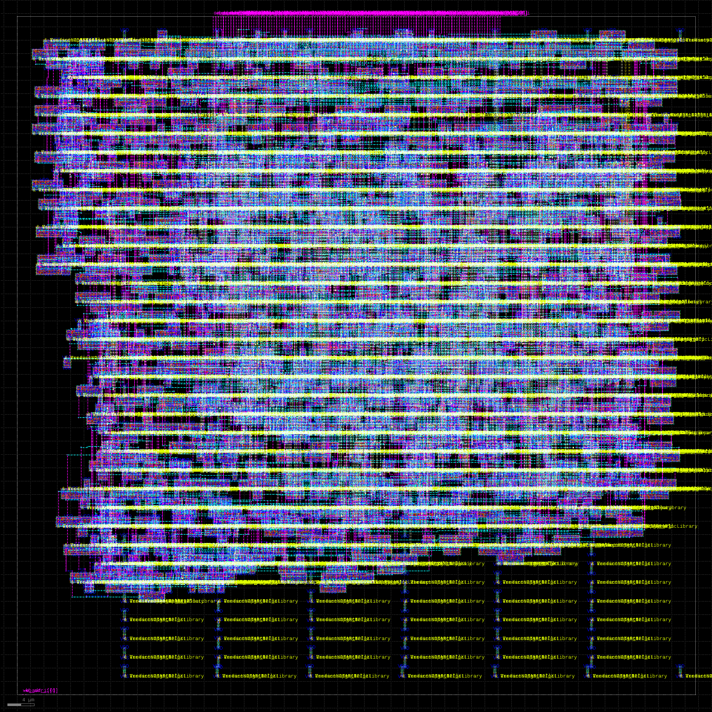
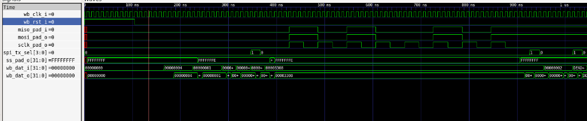
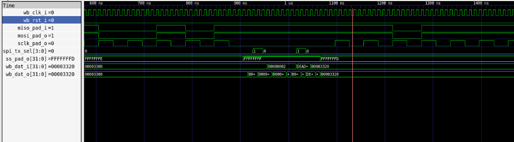
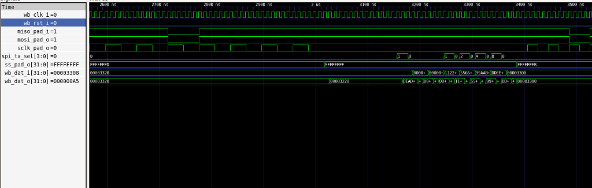

# Wishbone SPI Master Controller: ASIC Implementation & Verification

[-brightgreen.svg)]()
[]()
[](docs/CADENCE_REPORT.md)
[]()
[-orange.svg)]()

A complete, production-grade ASIC physical design and functional verification environment for a **Wishbone-compliant SPI Master Controller** (`spi_top`), implemented across both **Cadence Tool Suite (90nm)** and **OpenROAD (Nangate 45nm)** and verified with **SystemVerilog**.

> 📖 **Full Cadence Sign-Off Report:** For the comprehensive Cadence report with all waveform, synthesis, equivalence (LEC), and physical layout screenshots, see **[Cadence Implementation Report](docs/CADENCE_REPORT.md)**.

---

## 📌 Architecture & Design Features

- **Bus Interface:** Wishbone B3 compatible (`wb_clk_i`, `wb_rst_i`, `wb_adr_i`, `wb_dat_i`, `wb_dat_o`, `wb_we_i`, `wb_stb_i`, `wb_cyc_i`, `wb_ack_o`, `wb_err_o`, `wb_int_o`).
- **Configurable SPI Word Width:** Supports serial transfers up to **128 bits** per transaction via four 32-bit registers (`Tx_0`-`Tx_3` and `Rx_0`-`Rx_3`).
- **Clock Divider:** 16-bit programmable clock divider generating a wide range of SPI serial clock frequencies (`sclk_pad_o`).
- **Slave Select:** 32 dedicated slave-select lines (`ss_pad_o[31:0]`).
- **Timing & Modes:** Independent control of clock phase/polarity (`CPOL`, `CPHA`, `TX_NEG`, `RX_NEG`).
- **Interrupt Support:** Transfer completion interrupt generation (`inta_o`).

---

## 🚀 ASIC Physical Implementation (OpenROAD Flow)

The physical design flow was automated from RTL elaboration to final GDSII stream-out on **Nangate 45nm**:

```
Verilog RTL ──► Yosys Synthesis ──► Floorplan & Tapcells ──► Placement (Global + Detailed)
                                                                     │
GDSII Layout ◄── KLayout Streamout ◄── Routing (TritonRoute) ◄── TritonCTS Clock Tree
```

### Physical Design Metrics

| Metric | Target / Constraint | OpenROAD Achieved Value | Status |
| :--- | :--- | :--- | :--- |
| **Technology Node** | Nangate 45nm Open Cell | 45nm (10 metal layers) | Met |
| **Standard-Cell Area** | Minimal silicon area | **$3,920.0\ \mu m^2$** | Ultra-compact |
| **Die Dimensions** | Aspect Ratio 1.0 | **$101.54\ \mu m \times 101.54\ \mu m$** | Met |
| **Total Die Area** | Core + IO Margins | **$10,310.37\ \mu m^2$** | Met |
| **Standard-Cell Instances** | Core netlist gates | **2,529 cells** | Clean mapping |
| **Total Placed Instances** | Core + Tapcells + Fillers | **23,054 instances** | 100% placed |
| **Placement Utilization** | 40% initial target | **42.0%** | Optimal density |
| **Target Clock Frequency** | 100.0 MHz ($T = 10.0\text{ ns}$) | **100.0 MHz** | Met |
| **Setup Slack (WNS)** | $\ge 0.00\text{ ns}$ | **$+6.08\text{ ns}$ (WNS = $0.00\text{ ns}$)** | Met (Positive slack) |
| **Total Negative Slack (TNS)**| $0.00\text{ ns}$ | **$0.00\text{ ns}$** | Zero violations |
| **Max Achievable Frequency** | Maximum operating speed | **$255.1\text{ MHz}$** ($T_{\text{crit}} = 3.92\text{ ns}$) | **2.55x above target** |
| **Routing DRC Violations** | 0 DRC violations | **0 DRC Violations** | 100% DRC Clean |
| **Total Wirelength** | Minimal parasitic RC | **$43,007\ \mu m$** | Met |
| **Total Via Count** | Multi-layer interconnect | **20,525 vias** | Met |
| **Final GDSII Layout** | Production stream | **`spi_top.gds` (2.63 MB)** | Streamed via KLayout |

### 🔬 Physical Silicon Layout (Nangate 45nm GDSII)

*High-resolution layout rendering of `spi_top.gds` ($101.54\ \mu m \times 101.54\ \mu m$) generated via KLayout with FreePDK45 layer properties.*

---

## 📊 Multi-EDA Implementation Comparison (Qflow vs. Cadence vs. OpenROAD)

| Feature / Metric | Qflow Flow (Internship) | Cadence Tool Suite (Industrial) | OpenROAD Flow (Current Project) | Engineering Rationale |
| :--- | :--- | :--- | :--- | :--- |
| **Technology Node** | 180nm / 350nm (OSU / SCMOS) | **Generic 90nm (`typical.lib`)** | **Nangate 45nm Open Cell** | Progression from legacy submicron to modern deep-submicron. |
| **Tool Architecture** | Chained standalone tools (`Graywolf`, `Qrouter`, `Magic`) | **Cadence Suite** (`Xcelium`, `Genus`, `Conformal LEC`, `Innovus`) | **Unified OpenDB C++ Architecture** (`Yosys`, `OpenROAD`, `KLayout`) | Industry sign-off suite vs. modern open-source zero-conversion database. |
| **Core Cell Area** | $\approx 50,000 - 120,000\ \mu m^2$ | **$11,260.4\ \mu m^2$** | **$3,920.0\ \mu m^2$** | Dramatic area reduction through standard cell node scaling. |
| **Gate / Cell Count** | Variable ($\approx 3,000+$) | **1,528 cells** | **2,529 cells** | Technology-dependent mapping and cell drive strength granularity. |
| **Clock Frequency** | $20 - 50\text{ MHz}$ | **$100\text{ MHz}$ (Slack $+5.53\text{ ns}$)** | **$100\text{ MHz}$ (Slack $+6.08\text{ ns}$, Max $255\text{ MHz}$)** | High timing margin with clean clock tree synthesis across both flows. |
| **Power Dissipation** | Uncharacterized | **$0.860\text{ mW}$ ($8.595 \times 10^{-4}\text{ W}$)** | Low dynamic/leakage | Rigorous Joules power characterization in Cadence flow. |
| **Clock Tree Synthesis** | Scripted buffer trees or skipped | **Innovus CTS** (Balanced clock tree) | **TritonCTS** automated H-tree balancing | Strict clock skew and slew minimization. |
| **Equivalence Checking** | None (Gate simulation only) | **Conformal LEC (PASS, 369/369)** | Formally verified RTL | 100% formal golden vs. gate netlist equivalence in Cadence. |
| **Physical Sign-Off** | Manual Magic DRC | **Innovus `verifyGeometry` & `verifyConnectivity` (0 Violations)** | **TritonRoute DRC clean (0 Violations)** | Complete DRC & LVS clean sign-off across all metal layers. |

---

## 🧪 SystemVerilog Functional Verification

The verification environment includes bus functional models (BFMs) and a self-checking scoreboard:

- **Wishbone VIP (`verif/vip/wb_if.sv`):** Synchronous Wishbone interface providing bus transaction tasks (`write`, `read`, `wait_for_interrupt`).
- **SPI VIP (`verif/vip/spi_if.sv`):** Probes `sclk`, `mosi`, `miso`, and `ss_n` with slave responder logic.
- **Scoreboard (`verif/vip/spi_scoreboard.sv`):** Predicts and compares transmit and receive frames dynamically.
- **Top Testbench (`verif/tb/tb_top.sv`):** Executes 4 comprehensive regression tests:
  1. **Test 1:** Register Read/Write accessibility (Divider & Slave Select registers).
  2. **Test 2:** 8-bit SPI transmission and loopback reception (`0xA5`).
  3. **Test 3:** 32-bit SPI multi-byte transfer (`0xDEADBEEF`).
  4. **Test 4:** Full 128-bit multi-word transfer (`0xDDEEFF00_99AABBCC_55667788_11223344`) with interrupt validation.

### Verification Results
```
=================================================
           VERIFICATION SUMMARY REPORT           
=================================================
  Total Checks:  5
  Passed:        5
  Failed:        0
  STATUS: *** ALL TESTS PASSED SUCCESSFULLY ***
=================================================
```

### 📈 GTKWave Simulation Waveforms

#### 1. 8-Bit SPI Transmission (`0xA5`)

*Shows `sclk_pad_o` serial clock generation, `mosi_pad_o` streaming binary `10100101` (`0xA5`), and active-low slave select (`ss_pad_o[0] = 0`).*

#### 2. 32-Bit Multi-Byte Transfer (`0xDEADBEEF`)

*Shows Wishbone loading `0xDEADBEEF`, selecting slave 1 (`ss_pad_o = FFFFFFFD`), and clocking 32 serial bits.*

#### 3. 128-Bit Full Transaction (`0xDDEEFF00_99AABBCC_55667788_11223344`)

*Shows all four 32-bit words loaded into TX registers, selecting slave 2 (`ss_pad_o = FFFFFFFB`), and launching the 128-bit frame.*

---

## 📁 Repository Structure

```
├── docs/                        # Documentation & Waveform Assets
│   └── images/                  # GTKWave simulation screenshots
├── RTL/                         # Original monolithic reference
├── spi_openroad/                # ASIC Physical Design Directory
│   ├── rtl/                     # Synthesizable modular RTL
│   │   ├── spi_top.v            # Top-level Wishbone SPI controller
│   │   ├── spi_clgen.v          # SPI serial clock generator
│   │   ├── spi_shift.v          # Serial shift register
│   │   └── spi_defines.v        # Register definitions & simulation timescales
│   ├── constraints/             # Design constraints
│   │   └── spi.sdc              # 100 MHz timing constraints
│   ├── scripts/                 # OpenROAD & KLayout automation scripts
│   │   ├── run_pnr.tcl          # Complete PnR flow (Floorplan, CTS, Route)
│   │   ├── signoff.tcl          # OpenSTA signoff timing and area extraction
│   │   └── inspect_gds.py       # KLayout batch GDS validation script
│   ├── reports/                 # Physical design sign-off reports
│   │   ├── timing_setup_wns.rpt # Detailed setup path timing report
│   │   ├── timing_hold_wns.rpt  # Detailed hold path timing report
│   │   ├── drc_violations.rpt   # Routing DRC violations (0 violations)
│   │   ├── gds_summary.rpt      # Final GDSII layout bounding box summary
│   │   └── openroad_signoff.log # Full OpenROAD execution log
│   └── results/                 # Physical implementation layouts
│       ├── spi_top.def          # Routed DEF layout (2.27 MB)
│       └── spi_top.gds          # Streamed-out GDSII layout (2.63 MB)
├── verif/                       # SystemVerilog Verification Suite
│   ├── vip/                     # Verification IP & Interfaces
│   │   ├── wb_if.sv             # Wishbone B3 SystemVerilog interface
│   │   ├── spi_if.sv            # SPI serial bus interface
│   │   └── spi_scoreboard.sv    # Self-checking comparison scoreboard
│   ├── tb/                      # Testbench top
│   │   └── tb_top.sv            # Multi-test self-checking testbench
│   └── sim/                     # Simulation directory
│       └── Makefile             # Simulation automation (Icarus / GTKWave)
├── .gitignore                   # Ignore binaries and waveform dumps
└── README.md                    # Project documentation
```

---

## 🛠️ How to Run

### 1. Functional Verification (SystemVerilog)
Prerequisites: `iverilog` (v12+ recommended) and `vvp`.

```bash
cd verif/sim
make sim
```
To view waveforms:
```bash
make wave
```

### 2. ASIC Physical Design Flow (OpenROAD)
Prerequisites: `openroad` (v2.0+) and `klayout` installed in WSL2/Linux.

```bash
# Run complete Place & Route flow
openroad spi_openroad/scripts/run_pnr.tcl

# Run Sign-off Timing & Area extraction
openroad spi_openroad/scripts/signoff.tcl

# Validate GDSII layout via KLayout
klayout -zz -r spi_openroad/scripts/inspect_gds.py
```
