# Cadence ASIC Implementation & Sign-off Report: SPI Master Controller

This report documents the complete ASIC design, functional verification, logic synthesis, formal verification, and physical implementation flow performed in the **Cadence Tool Suite** using the **90nm Standard Cell Technology Library** (`typical.lib`).

---

## 📑 Table of Contents
1. [Flow Overview & Toolchain](#1-flow-overview--toolchain)
2. [Stage 1: Functional Simulation & Verification (Xcelium & SimVision)](#stage-1-functional-simulation--verification-xcelium--simvision)
3. [Stage 2: Logic Synthesis & Optimization (Genus)](#stage-2-logic-synthesis--optimization-genus)
4. [Stage 3: Formal Verification / Logic Equivalence Checking (Conformal LEC)](#stage-3-formal-verification--logic-equivalence-checking-conformal-lec)
5. [Stage 4: Physical Design & Implementation (Innovus)](#stage-4-physical-design--implementation-innovus)
6. [Stage 5: Physical Sign-Off (DRC & LVS)](#stage-5-physical-sign-off-drc--lvs)
7. [Comprehensive Cadence Flow Metric Summary](#comprehensive-cadence-flow-metric-summary)
8. [Useful Images Reference Catalog](#useful-images-reference-catalog)

---

## 1. Flow Overview & Toolchain

The digital implementation was carried out end-to-end within the Cadence environment:

```
RTL Verification (Xcelium / SimVision)
                  │
                  ▼
Logic Synthesis & Mapping (Genus 21.14, 90nm typical.lib)
                  │
       ┌──────────┴──────────┐
       ▼                     ▼
Formal Equivalence (LEC)   Physical Design (Innovus 21.15)
(Golden RTL vs Netlist)      ├── Floorplanning & Power Mesh (PDN)
       │                     ├── Standard Cell Placement
       │                     ├── Clock Tree Synthesis (CTS)
       │                     ├── Post-CTS Timing Opt (Setup/Hold Clean)
       │                     ├── Filler Cell Insertion
       │                     ├── Detailed Routing (M1-M9)
       │                     └── Physical Sign-off (DRC & LVS Clean)
```

| ASIC Stage | Cadence Tool | Input Files | Primary Outputs |
| :--- | :--- | :--- | :--- |
| **Functional Simulation** | Cadence Xcelium / SimVision | SystemVerilog RTL, Testbench, VIP | Simulation waveforms, transaction logs |
| **Logic Synthesis** | Cadence Genus 21.14 | RTL, SDC constraints (`con_spi.sdc`), `typical.lib` | Gate-level Netlist, SDF, SDC, Timing/Area/Power reports |
| **Formal Verification** | Cadence Conformal LEC | Golden RTL, Synthesized Netlist, `typical.lib` | Keypoint mapping report, Verification PASS |
| **Physical Implementation** | Cadence Innovus 21.15 | Netlist, LEF, SDC, Liberty | Placed & Routed Layout, DEF, Clock tree, Final reports |
| **Physical Sign-off** | Cadence Innovus Verification | Routed Database | `verifyGeometry` (DRC), `verifyConnectivity` (LVS) |

---

## Stage 1: Functional Simulation & Verification (Xcelium & SimVision)

Functional verification was executed using the Cadence Xcelium digital simulator with SimVision GUI:
```bash
xrun spi_defines.v spi_clgen.v spi_shift.v spi_top.v tb_top.sv -access +rwc -gui
```

### 1. Design Browser & Hierarchy
The design browser verifies clean elaboration of all top-level Wishbone and SPI signals, slave-select vectors, and modular sub-blocks (`spi_clgen`, `spi_shift`).

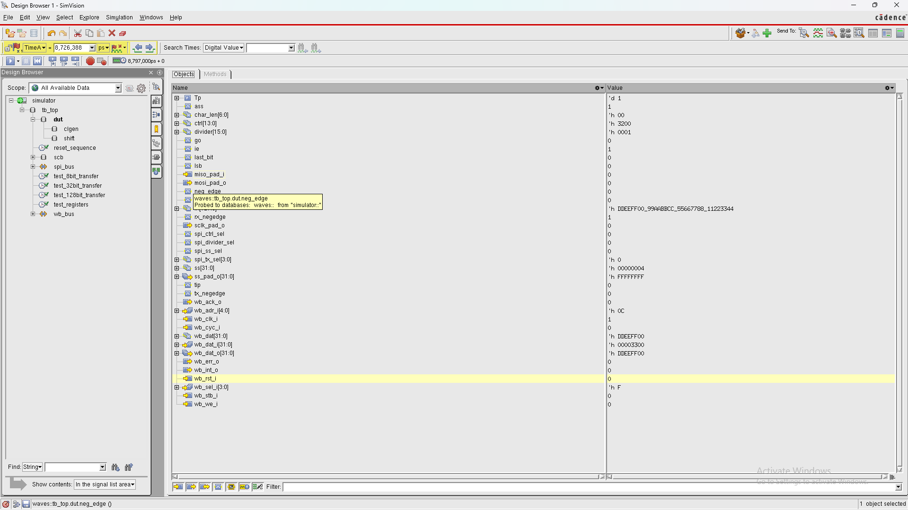
*Figure 1: Cadence SimVision Design Browser displaying design hierarchy, port list, and register structures.*

### 2. Multi-Test Simulation Waveforms
The test suite validates SPI Modes (CPOL/CPHA), clock division, and word-lengths from 8-bit to full 128-bit transfers:

- **8-bit Transfer (`0xA5`):** Shows divider initialization, slave assertion (`ss_pad_o[0] = 0`), and serial bit transmission.
  
  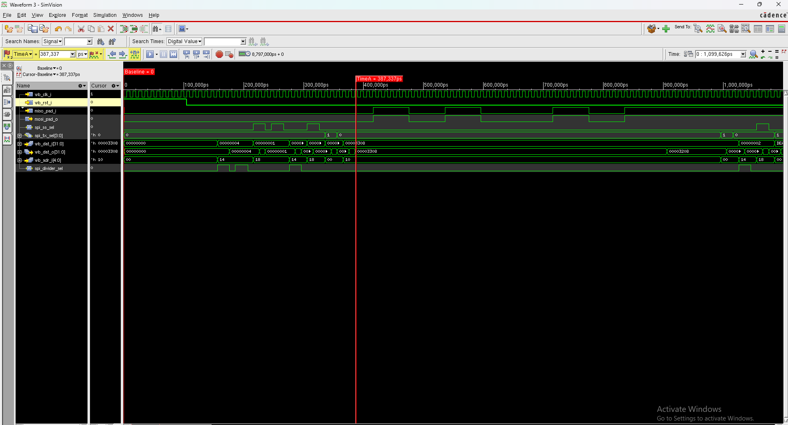
  *Figure 2: SimVision waveform for 8-bit SPI transaction with 50% duty cycle serial clock generation.*

- **32-bit Multi-Byte Transfer (`0xDEADBEEF`):** Shows Wishbone bus write cycles and continuous 32 serial clock cycles for slave 1.
  
  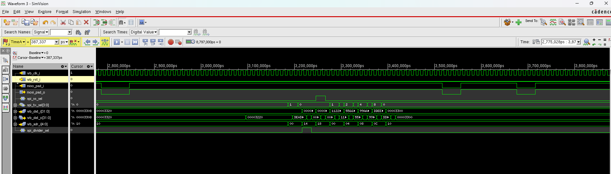
  *Figure 3: SimVision waveform for 32-bit transfer demonstrating multi-byte streaming.*

- **128-bit Full Transaction with Interrupt:** Displays sequential loading of 4 TX registers (`Tx_0` to `Tx_3`), serial shifting across 128 clock periods, and the interrupt assertion (`inta_o = 1`) signaling transfer completion.
  
  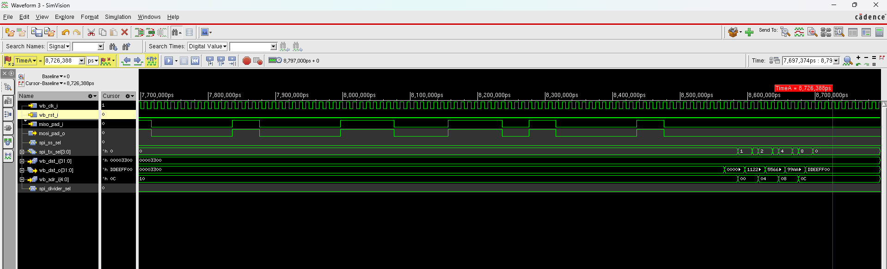
  *Figure 4: SimVision waveform for full 128-bit transaction and interrupt generation.*

### 3. RTL Architectural Schematic
The elaborated hardware schematic illustrates the modular division between the clock generator (`clgen`), 128-bit shift register core (`shift`), Wishbone control logic, and output multiplexers.

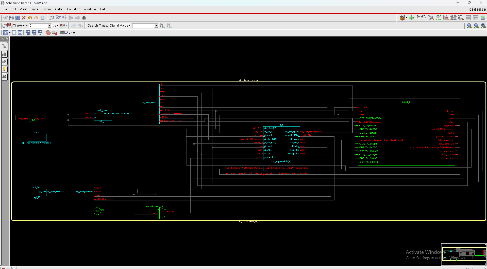
*Figure 5: Elaborated RTL architectural schematic visualized in SimVision Schematic Viewer.*

---

## Stage 2: Logic Synthesis & Optimization (Genus)

Logic synthesis was carried out using Cadence Genus 21.14 targeted to the 90nm standard cell digital library (`typical.lib`).

```bash
genus -f syn_spi.tcl -gui
```

### 1. Gate-Level Synthesized Schematic
The RTL registers and combinational control logic were mapped to 90nm standard cells:

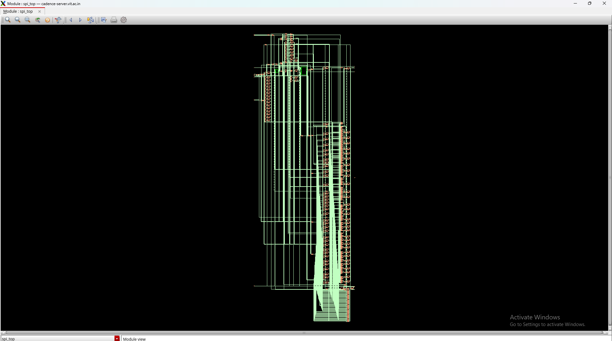
*Figure 6: Synthesized gate-level netlist schematic in Genus GUI.*

### 2. Synthesis Summary & Timing Slack
- **Target Clock Period:** $10.0\text{ ns}$ ($100\text{ MHz}$)
- **Setup Slack:** **$+6,604\text{ ps}$ ($+6.604\text{ ns}$)** (Positive slack, timing met comfortably)
- **Critical Path Endpoint:** `shift/data_reg[103]/D`
- **Cost Group:** `I2R` (Input-to-Register)
- **Cell Count:** **1,528 standard cells**
- **Cell Area:** **$11,260.401\ \mu m^2$**
- **Design Rule Check:** Max capacitance: **No violations**

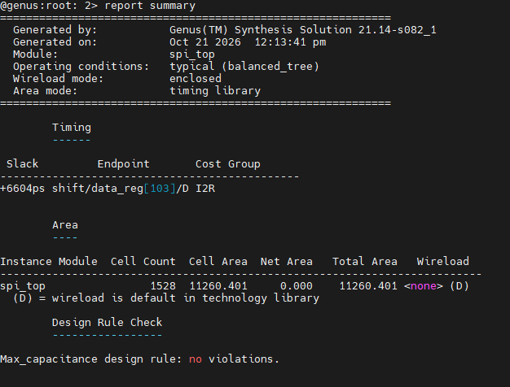
*Figure 7: Genus synthesis summary report (`report summary`).*

### 3. Critical Path Timing Report
The timing path breakdown shows data originating from Wishbone address bus `wb_adr_i[2]` through decoding logic (inverters, NOR, NAND, and OAI gates) arriving at data register input with a total data path latency of only $1,282\text{ ps}$:

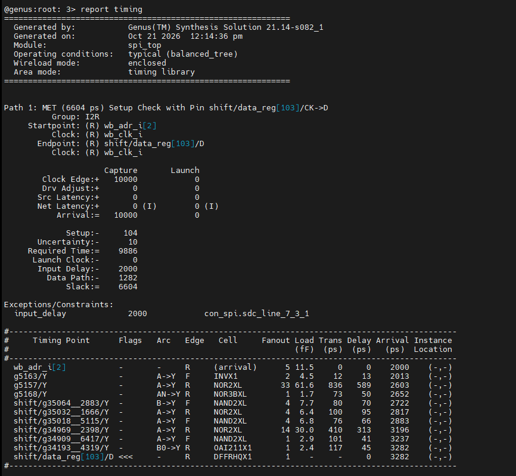
*Figure 8: Critical path setup timing report from Genus (`report timing`).*

### 4. Power Dissipation Analysis (Joules Engine)
Power analysis was conducted using Cadence Joules under typical operating conditions ($V_{DD} = 1.0\text{ V}$, $T = 25^\circ\text{C}$):

| Power Category | Leakage Power (W) | Internal Power (W) | Switching Power (W) | Total Power (W) | Percentage |
| :--- | :--- | :--- | :--- | :--- | :--- |
| **Registers** | $2.187 \times 10^{-5}$ | $5.786 \times 10^{-4}$ | $1.557 \times 10^{-5}$ | $6.160 \times 10^{-4}$ | **71.67%** |
| **Logic** | $2.171 \times 10^{-5}$ | $1.041 \times 10^{-4}$ | $7.339 \times 10^{-5}$ | $1.992 \times 10^{-4}$ | **23.17%** |
| **Clock Tree** | $0.000$ | $0.000$ | $4.430 \times 10^{-5}$ | $4.430 \times 10^{-5}$ | **5.15%** |
| **Total** | **$4.358 \times 10^{-5}\text{ W}$ (5.07%)** | **$6.827 \times 10^{-4}\text{ W}$ (79.43%)** | **$1.333 \times 10^{-4}\text{ W}$ (15.50%)** | **$8.595 \times 10^{-4}\text{ W}$ (~0.86 mW)** | **100.0%** |

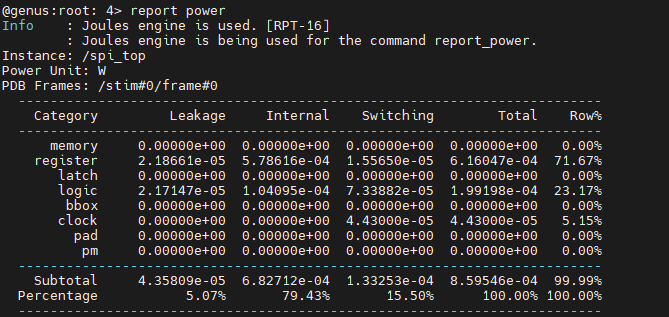
*Figure 9: Genus Joules power consumption breakdown (`report power`).*

### 5. Hierarchical Area Breakdown
The core area is predominantly occupied by the 128-bit serial shift register (`spi_shift`):

| Hierarchy Instance | Module Name | Cell Count | Cell Area ($\mu m^2$) | Area % |
| :--- | :--- | :--- | :--- | :--- |
| `spi_top` (Total) | `spi_top` | **1,528** | **$11,260.401$** | **100.0%** |
| `shift` | `spi_shift` | 1,067 | $7,161.031$ | 63.59% |
| Top-level control & bus | `spi_top` (glue) | 357 | $3,322.791$ | 29.51% |
| `clgen` | `spi_clgen` | 104 | $776.579$ | 6.90% |

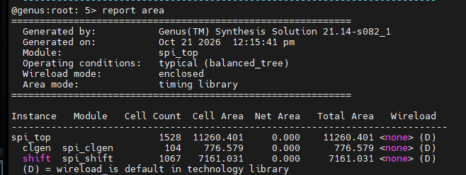
*Figure 10: Hierarchical area breakdown report from Genus (`report area`).*

---

## Stage 3: Formal Verification / Logic Equivalence Checking (Conformal LEC)

To guarantee that logic synthesis introduced zero functional discrepancies, Cadence Conformal LEC was used to formally compare the **Golden RTL** (`spi_top.v`) against the **Revised Gate-Level Netlist** (`spi_top_netlist_typical.v`).

### 1. Keypoint Mapping
All state points and boundaries were mapped 1-to-1:
- Primary Inputs (PI): **47 / 47 mapped**
- Primary Outputs (PO): **69 / 69 mapped**
- Flip-Flops (DFF): **253 / 253 mapped**
- **Total Mapped Key Points:** **369 / 369**

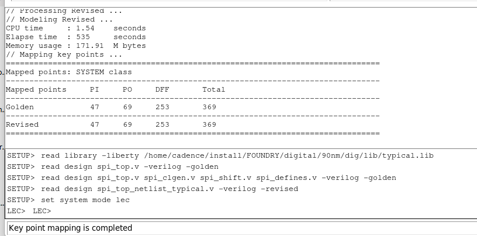
*Figure 11: Conformal LEC key points mapping between Golden RTL and Revised Netlist.*

### 2. Formal Equivalence Result
The equivalence checker evaluated all comparison cones with **zero non-equivalences**, **zero aborts**, and **zero modeling differences**:

```
Verification Report:
-----------------------------------------------------------
Compare Results:  PASS
Non-equivalent points: 0
Incomplete verification: 0
```

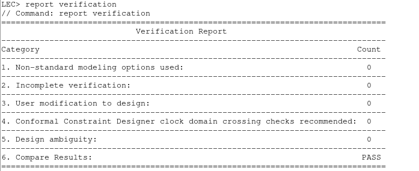
*Figure 12: Conformal LEC verification report confirming 100% formal equivalence (PASS).*

---

## Stage 4: Physical Design & Implementation (Innovus)

Physical design and backend Place & Route (PnR) were executed using Cadence Innovus Implementation System 21.15.

### 1. Design Initialization & Pre-Placement Timing
- Core standard cell area: $11,260.40\ \mu m^2$
- Core floorplan area: $16,058\ \mu m^2$
- Target placement density: **70.12%**
- Pre-placement setup timing: **WNS = $+4.778\text{ ns}$**, **TNS = $0.000\text{ ns}$**, Violating paths: **0**

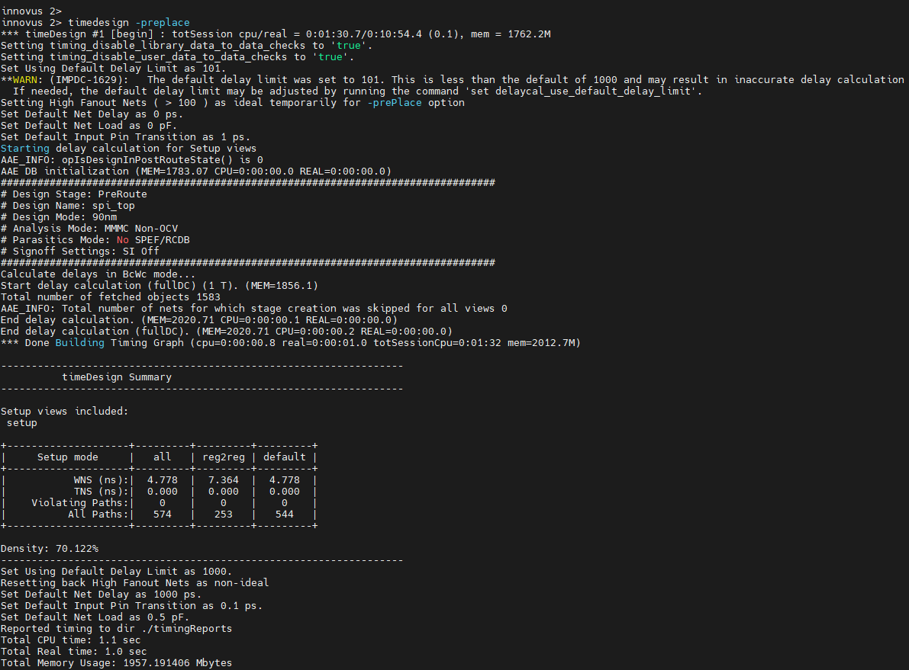
*Figure 13: Innovus pre-placement timing summary (`timeDesign -prePlace`).*

### 2. Floorplanning & Power Distribution Network (PDN)
The floorplan was constructed with power rings and orthogonal power stripes (M1 to M9) delivering uniform VDD and VSS supplies across the die to minimize IR drop:

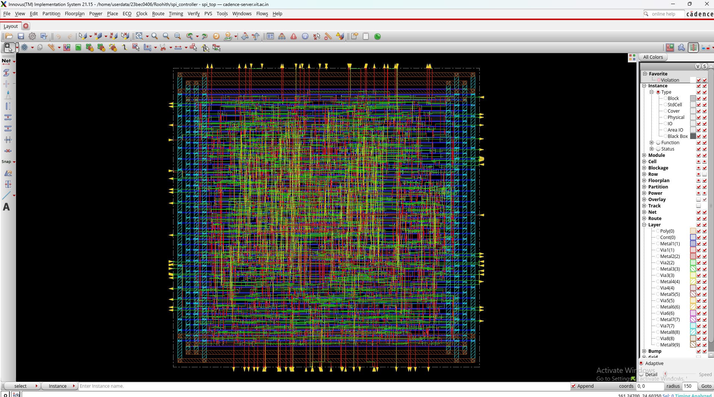
*Figure 14: Innovus floorplan layout showing core boundary, I/O pin allocation, and multi-layer power distribution mesh.*

### 3. Standard Cell Placement
1,528 standard cells were placed into core rows with timing-driven optimization minimizing total half-perimeter wirelength (HPWL):

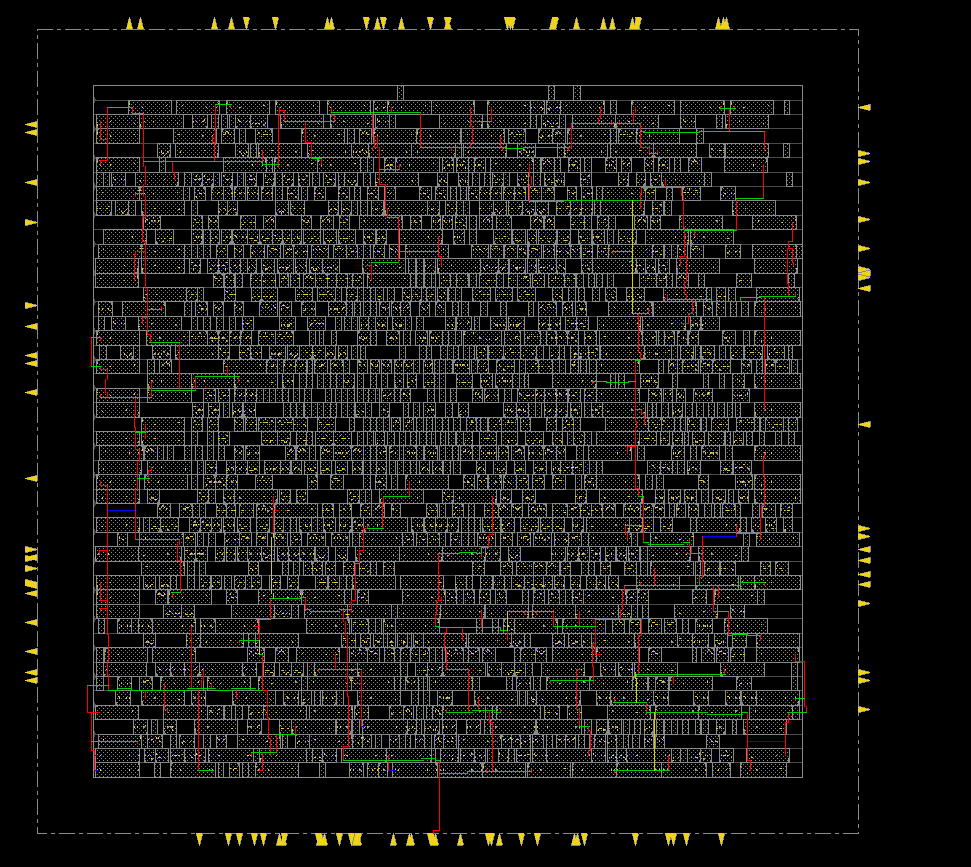
*Figure 15: Standard cell placement layout in Innovus core area.*

### 4. Post-CTS Timing & DRV Optimization
Clock Tree Synthesis (CTS) inserted balanced clock buffers to minimize skew across all 253 flip-flops. Post-CTS optimization (`optDesign -postCTS -hold -setup`) resolved all setup and hold times simultaneously:

- **Setup Slack (WNS):** **$+5.528\text{ ns}$** (0 violating paths)
- **Hold Slack (WNS):** **$+0.012\text{ ns}$** (0 violating paths)
- **Total Negative Slack (TNS):** **$0.000\text{ ns}$**
- **Design Rule Violations (DRVs):** Max Cap: **0**, Max Tran: **0**, Max Fanout: **0**, Max Length: **0**
- **Placement Density:** **70.086%**

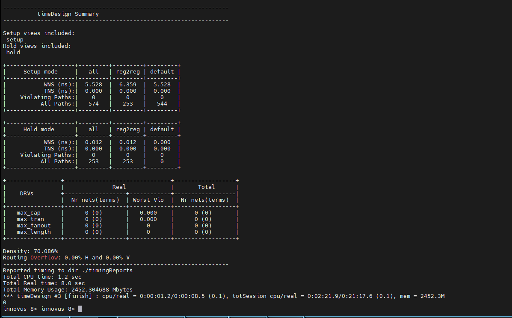
*Figure 16: Innovus post-CTS timing and DRV optimization report.*

### 5. Filler Cell Insertion ("After filling")
Filler cells were inserted into all unpopulated row segments to maintain continuous N-well/P-well diffusion and guard against antenna/DRC violations:

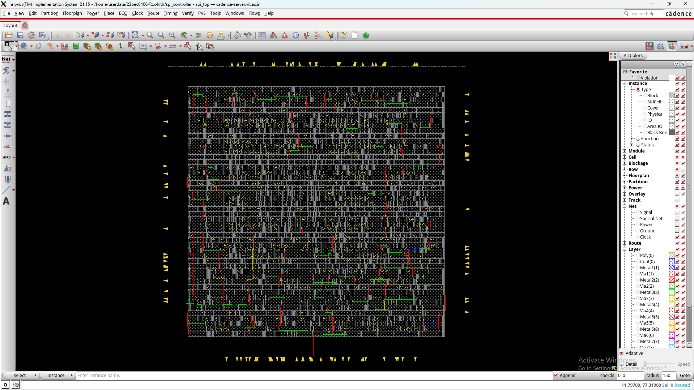
*Figure 17: Core layout after full filler cell insertion.*

### 6. Final Detailed Routing
Multi-layer detailed routing connected all standard cell signal pins, clock trees, and I/O pads across metal layers M1 through M9:

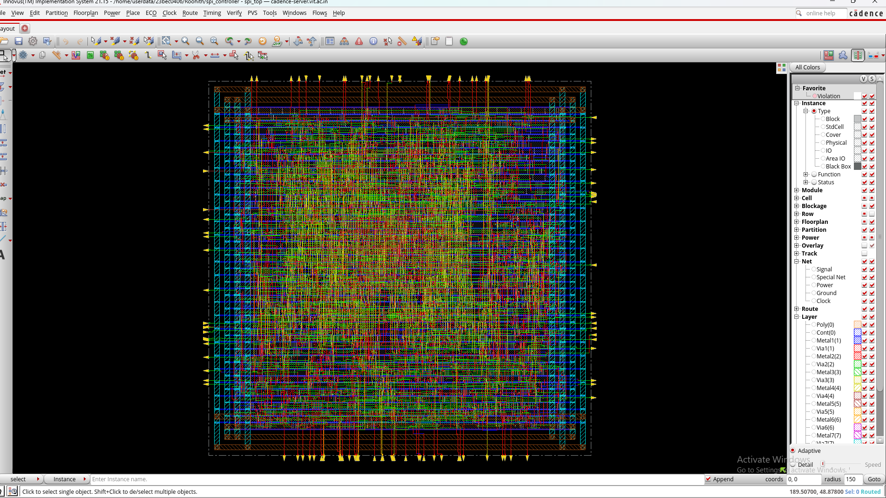
*Figure 18: Final routed silicon layout of the SPI Master Controller in Cadence Innovus.*

---

## Stage 5: Physical Sign-Off (DRC & LVS)

Physical verification confirmed 100% manufacturability and electrical connectivity.

### 1. Design Rule Checking (DRC)
Geometry verification (`verifyGeometry`) confirmed zero spacing, notch, overlap, antenna, or short violations:

```
Verification Complete : 0 Viols. 0 Wrngs.
Cells: 0, SameNet: 0, Wiring: 0, Antenna: 0, Short: 0, Overlap: 0
```

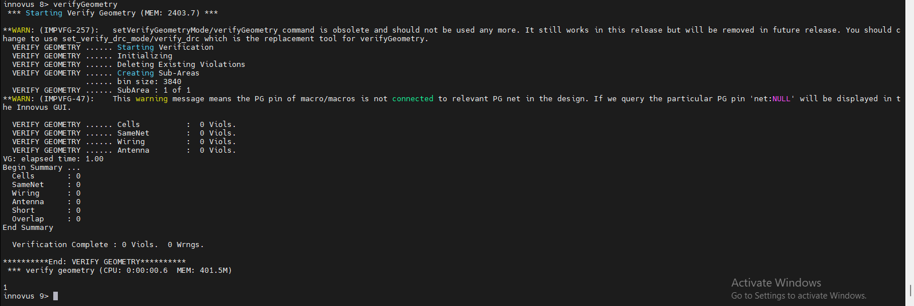
*Figure 19: Innovus `verifyGeometry` report confirming 0 DRC violations.*

### 2. Layout Versus Schematic (LVS / Connectivity)
Electrical connectivity verification (`verifyConnectivity`) confirmed zero open circuits, floating pins, or short circuits:

```
Design Name: spi_top
Begin Summary: Found no problems or warnings.
Verification Complete : 0 Viols. 0 Wrngs.
```

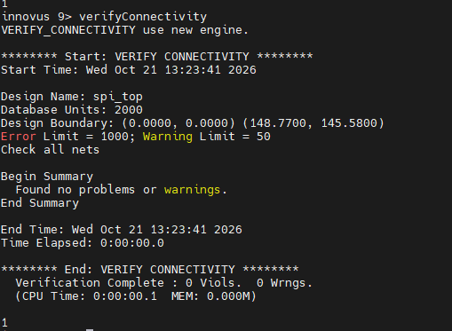
*Figure 20: Innovus `verifyConnectivity` report confirming 0 LVS violations.*

---

## Comprehensive Cadence Flow Metric Summary

| Flow Parameter | Target / Constraint | Cadence Achieved Result | Status |
| :--- | :--- | :--- | :--- |
| **Technology Node** | 90nm Digital Standard Cell | TSMC / Generic 90nm (`typical.lib`) | **Met** |
| **Clock Frequency** | 100.0 MHz ($T = 10.0\text{ ns}$) | **100.0 MHz** | **Met** |
| **Synthesis Setup Slack** | $\ge 0.00\text{ ps}$ | **$+6,604\text{ ps}$ (+6.604 ns)** | **Clean** |
| **Post-CTS Setup Slack (WNS)** | $\ge 0.00\text{ ns}$ | **$+5.528\text{ ns}$** | **Clean** |
| **Post-CTS Hold Slack (WNS)** | $\ge 0.00\text{ ns}$ | **$+0.012\text{ ns}$** | **Clean** |
| **Total Negative Slack (TNS)** | $0.00\text{ ns}$ | **$0.00\text{ ns}$** | **Zero Violations** |
| **Total Standard Cells** | - | **1,528 cells** | **Optimized** |
| **Total Flip-Flops (DFF)** | - | **253 sequential cells** | **100% Mapped** |
| **Standard Cell Area** | - | **$11,260.401\ \mu m^2$** | **Compact** |
| **Placement Density** | ~70% | **70.086%** | **Target Met** |
| **Total Power Consumption** | Low power dissipation | **$0.860\text{ mW}$ ($8.595 \times 10^{-4}\text{ W}$)** | **Ultra Low Power** |
| **Formal Equivalence (LEC)** | 100% golden vs gate match | **PASS (369/369 keypoints)** | **Formally Verified** |
| **DRC Violations (`verifyGeometry`)** | 0 violations | **0 Violations, 0 Warnings** | **DRC Clean** |
| **LVS Violations (`verifyConnectivity`)**| 0 violations | **0 Violations, 0 Warnings** | **LVS Clean** |

---

## Useful Images Reference Catalog

All extracted and organized high-resolution images are located in [`docs/images/cadence/`](file:///e:/SPI%20Master%20Controller/docs/images/cadence/):

| Image Filename | Stage | Description / Role in Project Report |
| :--- | :--- | :--- |
| `01_simvision_design_browser.png` | Verification | Displays design hierarchy and port/signal lists in SimVision |
| `02_simvision_waveform_8bit.png` | Verification | Waveform showing 8-bit SPI transmission |
| `03_simvision_waveform_32bit.png` | Verification | Waveform showing 32-bit transmission (`0xDEADBEEF`) |
| `04_simvision_waveform_128bit.png` | Verification | Waveform showing 128-bit full transaction with interrupt |
| `05_simvision_rtl_schematic.png` | Verification | Elaborated architectural block schematic |
| `06_genus_synthesized_schematic.png` | Synthesis | Gate-level schematic generated by Genus |
| `07_genus_report_summary.png` | Synthesis | High-level synthesis summary table (slack, area, rule checks) |
| `08_genus_report_timing.png` | Synthesis | Detailed setup critical path timing report |
| `09_genus_report_power.png` | Synthesis | Joules power report (leakage, internal, switching breakdown) |
| `10_genus_report_area.png` | Synthesis | Hierarchical standard cell area table (`shift`, `clgen`) |
| `11_lec_keypoint_mapping.png` | Formal (LEC) | Key points mapping of all 369 PIs, POs, and DFFs |
| `12_lec_verification_pass.png` | Formal (LEC) | Conformal LEC formal verification PASS certificate |
| `13_innovus_preplace_timing.png` | Physical Design | Pre-placement timing check and initial density |
| `14_innovus_floorplan_power_grid.png` | Physical Design | Core boundary, I/O pin allocation, and power mesh (rings/stripes) |
| `15_innovus_std_cell_placement.png` | Physical Design | Standard cell placement rows |
| `16_innovus_postcts_timing_opt.png` | Physical Design | Post-CTS timing closure (WNS setup +5.528ns, hold +0.012ns, 0 DRVs) |
| `17_innovus_filler_cells_insertion.png`| Physical Design | Layout after filler cell insertion |
| `18_innovus_final_routed_layout.png` | Physical Design | Complete multi-layer routed silicon layout |
| `19_innovus_verify_geometry_drc.png` | Sign-off | DRC sign-off log (0 violations, 0 warnings) |
| `20_innovus_verify_connectivity_lvs.png`| Sign-off | LVS connectivity sign-off log (0 violations, 0 warnings) |
